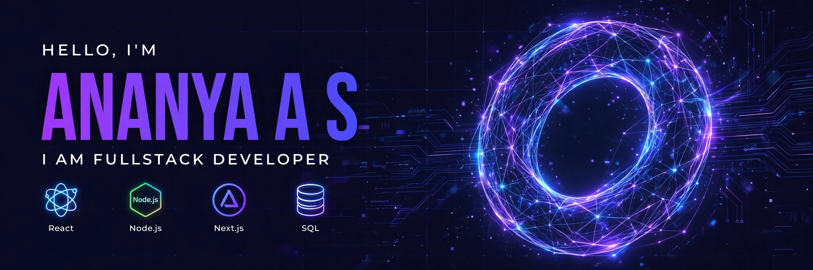

### Hi There, Welcome to my Github profile! 👋

I am Ananya A S, a passionate Fullstack Developer from Kerala, India, working in both backend and frontend programming. I love solving problems, building live projects, and deploying fullstack apps. I am also confident with Data Structures and Algorithms, REST APIs, and Database Management.

🚀 **Live Project:** [Shortly - URL Shortener + Analytics](https://shortly-analytics-api.onrender.com)

---

### 🛠️ Skills

- **📝 Languages:**

- **🧩 Frameworks:**

- **🗄️ Databases:**

- **💻 Application and Tools:**

---

### 📊 Github Stats

---

### 🔗 Connect with me

⚡ New Project: <a href="https://github.com/Ananya0-alt/instant-portfolio-builder">instant-portfolio-builder</a>

 ̶ ̶ ̶ ̶ ̶ ̶
Ok
---

### 🐍 My Contributions

  <picture>
    <source media="(prefers-color-scheme: dark)" srcset="https://raw.githubusercontent.com/Ananya0-alt/Ananya0-alt/output/github-contribution-grid-snake-dark.svg">
    <source media="(prefers-color-scheme: light)" srcset="https://raw.githubusercontent.com/Ananya0-alt/Ananya0-alt/output/github-contribution-grid-snake.svg">
    
  </picture>

